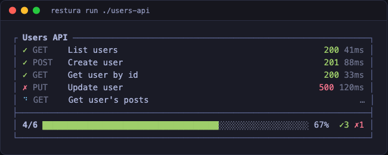
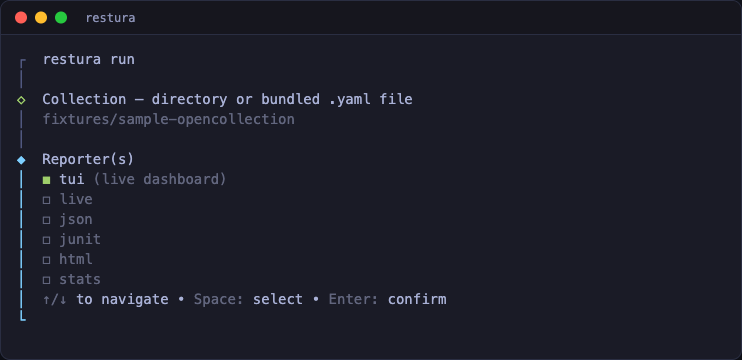
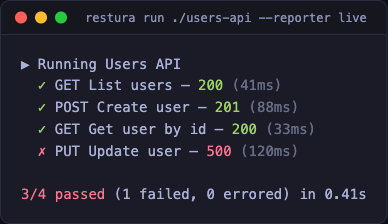

# restura-cli

Run Restura API collections in CI — assert with scripts, get JUnit / HTML / JSON reports.



## Install

```bash
npm install -g restura-cli
# or, no install:
npx restura-cli run ./my-collection
```

Requires Node.js 24+.

## Quick start

Export a collection from the Restura app (File → Export → OpenCollection directory), then:

```bash
restura run ./my-collection --reporter junit --reporter-output junit=results.xml
```

Exit code is `0` when every request passed, `1` if any failed, `2` on internal errors (missing collection, bad flags).

## OWS workflows

Run a portable Open Workflow Specification artifact from an OpenCollection workspace:

```bash
restura workflow run ./my-workspace billing --env ./ci.env
```

| Flag                | Default | Description                                                    |
| ------------------- | ------- | -------------------------------------------------------------- |
| `--env <file>`      |         | JSON or YAML env file: a flat `{ "key": "value" }` object (string values only) or a Postman environment export. Hoppscotch environment exports are not read; import those in the app. |
| `--timeout <ms>`    | `30000` | Workflow timeout cap.                                          |
| `--allow-localhost` | `false` | Permit `localhost` / `127.0.0.1` targets (SSRF guard).         |
| `--allow-mutations` | `false` | Permit saved GraphQL mutation calls.                           |

The workspace must contain `opencollection.yml` and `workflows/billing/` with
`workflow.ows.json`, `bindings.restura.json`, and `layout.restura.json`. The
CLI accepts only the safe OWS profile: sequential `do`, `set`, `wait`, timeout
/ cancellation, and binding-only HTTP calls to saved requests. Inline endpoints,
credentials, non-HTTP calls, and controls without a bounded runtime are rejected
before any network request is made.

## Interactive mode

Run `restura` (or `restura run`) with **no collection** in a terminal to launch a guided wizard — pick the collection, reporters, output paths, an optional env file, and whether to allow localhost, then it runs:

```bash
restura            # bare → wizard
restura run        # also → wizard when no <collection> is given
```



The wizard is **terminal-only**: piped output and CI never prompt. There, a missing collection is an error (exit 2) and bare `restura` prints help — so existing scripts and pipelines are unaffected. Cancelling (Ctrl-C / Esc) exits `130`.

By default, an interactive run shows a live dashboard (the `tui` reporter); piped/CI runs fall back to plain line output (the `live` reporter). See [Reporters](#reporters).

## Supported collection formats

The loader auto-detects these layouts:

| Layout                                   | Detected when…                                                                                          |
| ---------------------------------------- | ------------------------------------------------------------------------------------------------------- |
| **OpenCollection directory** (preferred) | the target directory contains `opencollection.yml` (or `.yaml`)                                         |
| **OpenCollection bundled file**          | the target path ends in `.yaml`/`.yml` (and is not a Postman v3 document)                               |
| **Legacy file-collection** (deprecated)  | the target directory contains `_collection.yaml`                                                        |
| **Postman v2.0 / v2.1**                  | a `.json` file whose `info.schema` is a Postman schema URL, or that has `info._postman_id`             |
| **Postman v3 single file**               | a `.json` / `.yaml` / `.yml` file whose root has `$kind: "collection"`                                  |
| **Postman v3 folder**                    | a directory (without the markers above) containing `*.request.yaml` or `.resources/definition.yaml`    |
| **Postman v3 archive**                   | a `.zip` file                                                                                           |

The legacy format prints a stderr deprecation warning the first time it's loaded.

### Postman collections

Postman input is parsed by the **same shared importer the Restura app uses** (`shared/collections/postman/`, [ADR 0034](../docs/adr/0034-postman-shared-parser-and-sidecar.md)), so a collection runs in CI the way it imports in the app. `pm.*` scripts are migrated to `rs.*` as on import.

- **Caps.** Untrusted input is bounded before it is read: at most 5,000 files, 10 MiB per file, 50 MiB in total and 50 MiB for a `.zip` (checked from the file size before reading, then inflated as a stream with a running byte count). A single `.json` / `.yaml` file may be up to 50 MiB.
- **Folders.** The CLI walks a v3 folder with `lstat` and **never follows symlinks**: a symlinked file or directory is skipped and listed in the import report. Each file is re-opened with `O_NOFOLLOW` and must still be the same regular file (device and inode) that the walk saw. A file swapped for a symlink, a FIFO or another file in between is refused. Only YAML / JSON files are read; other files under `.resources/` (external scripts, binaries) are listed as unread.
- **Import report.** Everything the importer dropped or approximated (unsupported auth, unsendable methods, saved responses, secret variables, MCP stdio items, item kinds with no Restura equivalent, …) is printed to **stderr**, grouped by kind with a count and the affected item names. The `json` reporter includes it as `importReport` (`{ sourceVersion, warnings[], skippedSymlinks? }`). Entries carry only names and fixed notes, never credentials.
- **`--strict-import`** refuses the run (exit `2`, nothing is sent) when the import report has any entry. It counts exactly the import report's entries plus skipped symlinks. The CLI's own platform skips (Kafka / MQTT / WebSocket / Socket.IO presets, the `[restura] skipping …` notices below) are not import loss and do not trip it.
- **Inherited auth.** When a folder (or the collection) uses a Postman auth type Restura cannot sign, the importer gives the requests that inherit from it an explicit "no auth" and a report entry each. They never inherit a credential from further up (for example the collection's bearer token).

What the CLI does with constructs it cannot run — it never runs them silently:

| Construct                                                                                     | CLI behaviour                                                                                                                                                                                                                  |
| --------------------------------------------------------------------------------------------- | ------------------------------------------------------------------------------------------------------------------------------------------------------------------------------------------------------------------------------ |
| Unsupported Postman auth (hawk, edgegrid, jwt, akamai, asap, …), on the request or inherited | **Not sent.** The request is reported as errored with `not sent: Postman auth type "…" is not supported…` and counted as "not sent" in the summary; it is never sent unauthenticated or with a credential from further up. |
| Explicit Postman `noauth` below a configured ancestor auth | **Not sent**, with `not sent: Postman auth is "No Auth", but Restura would substitute the auth of "…"`. Restura's `none` means inherit, so the CLI refuses rather than send a credential Postman would not send. It adds an `explicit-noauth` import-report entry, so `--strict-import` exits 2. A `noauth` request with no configured auth above it is sent normally. |
| MCP stdio items | **Never launched.** An imported stdio item becomes an empty placeholder folder named `<name> (MCP stdio, disabled)` with no request inside. The loader skips it with a stderr notice (`imported as an empty placeholder`), and it counts as an `mcp-stdio` import-report entry, so `--strict-import` exits 2. |
| Requests that are not sent (above)                                                            | Refused in the executor layer too, so `restura run`, OWS workflows and agent tools all refuse them. Their variables never abort a run in the secret-variable pre-check.                                                       |
| Kafka / MQTT items                                                                            | Skipped with a `[restura] skipping … preset` notice on stderr, as for OpenCollection presets. This is a platform skip (the CLI has no broker transport), not import loss: it is stderr-only and is **not** an import-report entry. |
| WebSocket / Socket.IO items                                                                   | Imported as native WebSocket / Socket.IO presets and skipped with a `[restura] skipping WebSocket preset "…"` (or `Socket.IO preset`) notice on stderr, like Kafka / MQTT. A platform skip, not an import-report entry. |
| LLM and data items                                                                            | Imported as empty placeholders and skipped with a `[restura] skipping "…"` notice on stderr. Each is also an `unsupported-item-kind` import-report entry, so `--strict-import` and the `json` reporter see them. |
| v3 secret (vault) and v2.1 `type: "secret"` variables                                                                   | Imported without a value as private variables, each adding an import-report entry (so `--strict-import` exits 2). A run that references one fails before sending anything unless you provide the value with `--env`; an empty value is never sent.                                                                   |

## Supported protocols

- **HTTP / REST** — full support
- **GraphQL** — runs as HTTP with body type `graphql`, shaped exactly as the app does (shared `shared/graphql/wire.ts`): the GraphQL-over-HTTP `Accept` header unless the request sets one; POST sends the JSON envelope, GET sends `query` / `variables` / `operationName` / `extensions` as URL params and refuses mutations and subscriptions before sending
- **gRPC** (unary) — honours the request's wire protocol: auto / Connect uses the Connect protocol (JSON-encoded, no proto compilation needed); gRPC-Web (`grpc-web` binary or `grpc-web-text`) encodes protobuf with the request's saved schema snapshot (reflection descriptors or uploaded `.proto`) and fails with `FAILED_PRECONDITION` when there is none; native gRPC (HTTP/2) is not available in the CLI and fails with `UNIMPLEMENTED` instead of silently using Connect. Auth types gRPC can't apply (AWS SigV4, OAuth 1.0, WSSE, Digest, NTLM) fail with `FAILED_PRECONDITION` before any I/O, as in the app, and metadata over 16 KiB fails with `INVALID_ARGUMENT`
- **SSE** — captures events for `--sse-duration` ms, or until `--sse-events N`
- **MCP** — runs the saved operation (`defaultMethod` + `defaultParams`, e.g. `tools/call` with `{"name":"…","arguments":{…}}`; `{{var}}`s resolved) over a real MCP session: the CLI connects and initializes **once per server per run** (same URL + transport + headers), reuses that session for every MCP item, and closes it when the run ends. Both `streamable-http` and legacy `http-sse` are supported. The response body handed to test scripts is the JSON-RPC reply without the id. On success it is `{ "jsonrpc": "2.0", "result": … }`, so `rs.response.json().result.isError` asserts a tool failure. On a JSON-RPC error it is `{ "jsonrpc": "2.0", "error": { code, message, data? } }`. Without assertions, a tool `isError: true` result or a JSON-RPC error fails the item with the reason. With assertions, the assertions decide, so negative tests can pass. Connection, HTTP and timeout failures always fail the item. Redirects are refused. An MCP item with no method fails with an actionable error, and there is no implicit `ping`. The `echo-local` generated collection includes runnable MCP examples with test scripts
- **WebSocket** — not run in collection batches (matches the desktop collection runner, which skips streaming protocols). A standalone executor exists for future wiring (`executors/websocket.ts`) but no collection format routes to it yet.
- **Kafka / MQTT connection presets** — skipped with a `[restura] skipping … preset` notice on stderr. Presets (`x-restura-kafka` / `x-restura-mqtt`) open in the desktop app; the CLI has no broker transport.
- **WebSocket / Socket.IO collection items** — skipped with a `[restura] skipping WebSocket preset "…"` (or `Socket.IO preset`) notice on stderr, like Kafka / MQTT. They open in the app.

Header-based auth (Bearer, Basic, API-key, OAuth2) is applied to HTTP/GraphQL, gRPC (as metadata), SSE, and MCP requests. MCP follows the app's MCP auth policy: credentials are header-only, so an API key set to query params or a request's own wire-signed auth fails the item before any I/O, an inherited wire-signed scheme is skipped, and `{{var}}`s in the MCP credential resolve against the run's variables. For OAuth2, a pre-supplied access token is used as-is; if the auth instead carries a token endpoint + client id (and no token), the CLI fetches one via the **client_credentials** grant — the only non-interactive grant suited to CI — caching it per token-url/client/scope for the run. Wire-signed schemes (AWS SigV4, OAuth1, WSSE) are signed at the wire on the HTTP path, and Digest is answered on the HTTP path after the server's `401` challenge (one retry, same-origin redirect chains only — the same shared core as the app). NTLM is not applied ([#1069](https://github.com/dipjyotimetia/restura/issues/1069)). Auth configured at the collection or folder level is inherited by descendant requests (nearest-ancestor-wins), and collection/folder-level pre-request and test scripts run against every descendant. `x-www-form-urlencoded` bodies are sent for both inline (`raw`) and structured (OpenCollection field-array) forms. `multipart/form-data` is supported with text fields and file parts (file content must be inline base64 on the part; file parts that reference a path on disk are not read). `protobuf` bodies are not yet supported by the CLI fetcher.

## CLI reference

```
restura run [collection] [options]
```

`[collection]` accepts a directory (any supported layout, including a Postman v3 folder), a bundled `.yaml`/`.yml` file, or a Postman `.json` / v3 `.zip` file (see [Postman collections](#postman-collections)). Omit it in a terminal to choose one via the [interactive wizard](#interactive-mode); in CI it is required.

| Flag                        | Default       | Description                                                                                                                       |
| --------------------------- | ------------- | --------------------------------------------------------------------------------------------------------------------------------- |
| `-e, --env <file>`          |               | JSON or YAML env file: a flat `{ "key": "value" }` object (string values only) or a Postman environment export (`*.postman_environment.json`; disabled rows skipped). `${VAR}` placeholders are expanded from `process.env`. Hoppscotch environment exports are not read; import those in the app. |
| `-g, --globals <file>`      |               | Postman globals export (or a flat key/value file). Lowest precedence: below `--env`.                                              |
| `--env-var <kv...>`         |               | Set variables, Newman style: `--env-var token=abc base=https://x`. Wins over `--env` and collection / folder variables.           |
| `-n, --iteration-count <n>` |               | Number of iterations. Without `--data`, runs the collection `n` times; with `--data`, the last row repeats past the end.          |
| `--delay-request <ms>`      |               | Pause between requests.                                                                                                           |
| `--reporter <list>`         | _auto_        | Comma-separated: `tui`, `live`, `json`, `junit`, `html`, `stats`. Defaults to `tui` in a terminal, `live` otherwise (piped / CI). |
| `--output <file>`           |               | Shorthand for single file reporter.                                                                                               |
| `--reporter-output <kv...>` |               | Per-reporter output: `--reporter-output junit=results.xml html=report.html`.                                                      |
| `--bail`                    | `false`       | Stop on first failure.                                                                                                            |
| `--timeout <ms>`            | `30000`       | Per-request timeout.                                                                                                              |
| `--allow-localhost`         | `false`       | Permit requests to `localhost` / `127.0.0.1`. Off by default (SSRF guard).                                                        |
| `--folder <path>`           |               | Only run requests under this folder path (slash-joined).                                                                          |
| `--include <pattern...>`    |               | Substring or glob (e.g. `users/*`). Repeatable.                                                                                   |
| `--exclude <pattern...>`    |               | Same syntax as `--include`. Applied after.                                                                                        |
| `--data <file>`             |               | CSV (with header row) or JSON array. Runs the collection once per row; row keys are exposed as vars.                              |
| `--max-iterations <n>`      |               | Cap iterations when a `--data` file is large.                                                                                     |
| `--retry <n>`               | `0`           | Retry attempts per failing request.                                                                                               |
| `--retry-on <list>`         | `network,5xx` | Comma-separated triggers: `network`, `5xx`, `4xx`, or specific status codes (`429,503`).                                          |
| `--sse-duration <ms>`       | `5000`        | How long to keep SSE streams open.                                                                                                |
| `--sse-events <n>`          |               | Stop SSE early after N events.                                                                                                    |
| `--insecure`                | `false`       | Skip TLS certificate verification (self-signed / staging). Insecure — use only when you trust the target.                         |
| `--ca <file>`               |               | PEM CA bundle to trust (private CA) without disabling verification.                                                               |
| `--client-cert <file>`      |               | PEM client certificate for mutual TLS (mTLS).                                                                                     |
| `--client-key <file>`       |               | PEM client private key for mutual TLS.                                                                                            |
| `--cert-passphrase <value>` |               | Passphrase for an encrypted `--client-key`.                                                                                       |
| `--proxy <url>`             |               | HTTP(S) proxy URL. Overrides `HTTP_PROXY`/`HTTPS_PROXY` and composes with the TLS options.                                        |
| `--external-secrets-config <file>` |        | YAML/JSON profiles for resolving external secret references (AWS Secrets Manager, Google Secret Manager, Azure Key Vault). See [External secrets](#external-secrets). |
| `--strict-import`           | `false`       | Postman input: exit `2` without running anything if the [import report](#postman-collections) has any entry.                     |

TLS options apply to all HTTPS traffic for the run (HTTP/GraphQL/gRPC/SSE/MCP). They are global flags rather than per-request settings; per-domain client certificates (collection `clientCertificates`) are not yet honored — pass the cert that the run needs via `--client-cert`.

Proxies: the standard `HTTP_PROXY` / `HTTPS_PROXY` / `NO_PROXY` environment variables are honored automatically, or pass `--proxy <url>` to set one explicitly (this is the form that composes with the TLS flags above — the env var does not). SOCKS proxies and collection-scoped proxy config are not yet supported.

HTTP version: a request's desktop-only **HTTP version** setting (`settings.httpVersion`, saved in OpenCollection as `x-restura-http`) is not applied by the CLI — undici negotiates the protocol as usual. When any request in the run sets a non-`auto` value, `restura run` prints one warning to stderr for the whole run rather than per request.

### External secrets

Auth fields can reference a secret held in a cloud secret manager instead of carrying the value. The CLI resolves those references only when you pass `--external-secrets-config` with an explicit profile for each provider; without it, a request that uses one errors instead of being sent unauthenticated. Profiles carry identity metadata only — never credentials — and no default credential chain or custom endpoint is used:

```yaml
profiles:
  - id: prod-aws
    provider: aws-secrets-manager
    region: us-east-1
    auth: { kind: workload-identity, roleArn: arn:aws:iam::123456789012:role/ci, tokenFile: /var/run/secrets/token }
  - id: gcp
    provider: google-secret-manager
    projectId: my-project
    auth: { kind: workload-identity, credentialConfigFile: ./gcp-wif.json }
  - id: vault
    provider: azure-key-vault
    vaultName: my-vault
    auth: { kind: named-profile }
```

AWS also accepts `{ kind: named-profile, profile: <name> }`; Azure workload identity takes `tenantId`, `clientId`, and `tokenFile`. Profile ids must be unique.

## Scripts and assertions

Pre-request and test scripts run in a sandboxed QuickJS WASM VM (no DOM, no filesystem, no network escape; 64 MB memory cap, 5 s execution timeout). `pm.sendRequest`, `pm.cookies`, and `pm.vault` are not wired in the CLI (no cookie jar or OS keychain in a CI process) and reject with a clear error.

```yaml
# request.http.yaml
name: Get user
method: GET
url: '{{API_BASE}}/users/1'
testScript: |
  pm.test("status is 200", () => pm.response.to.have.status(200));
  pm.test("response has name", () => {
    pm.expect(pm.response.json()).to.have.property("name");
  });
```

When a test script runs and defines any `pm.test(...)` assertion, those drive pass/fail. Otherwise pass/fail falls back to the transport outcome (HTTP 2xx, gRPC OK, etc.).

Variables set inside a script (`pm.environment.set('K', 'v')`) propagate to subsequent requests in the same run, including later iterations (a token fetched in iteration 1 is still set in iteration 2). A pre-request `pm.execution.skipRequest()` sends nothing and skips the test script; the request counts as passed and as `skipped` in the summary.

Collection, folder and request scripts of one phase run in order, each in its own block scope, so the same `const` / `let` at two levels is not a redeclaration error (`var` and function declarations are still shared, as before).

## Variables

Layered sources, in order of precedence (later wins), the same order the app's collection runner uses:

1. `--globals` file, then the `--env` file
2. Collection variables (declared in `opencollection.yml` or `_collection.yaml`, or the Postman collection's variables)
3. Folder variables of the folders above the request, outer → inner (inner wins). Secret, private and handle-backed folder variables are not resolved by the CLI.
4. `--env-var` values
5. Values a script set in an earlier iteration
6. Iteration row (when `--data` is set)
7. Values a script set earlier in this iteration

Substitutions are `{{NAME}}`. Unknown vars are left in place so the upstream sees them and you notice the gap.

### Dynamic helpers

Postman-compatible `{{$random*}}` / `{{$timestamp}}` helpers are expanded after user var substitution:

| Helper                 | Example                     |
| ---------------------- | --------------------------- |
| `{{$randomUUID}}`      | `f4d2e3...`                 |
| `{{$timestamp}}`       | `1700000000` (unix seconds) |
| `{{$isoTimestamp}}`    | `2026-05-22T13:42:00Z`      |
| `{{$randomEmail}}`     | `alice.42@example.com`      |
| `{{$randomFirstName}}` | `Olivia`                    |
| `{{$randomIP}}`        | `192.0.2.4`                 |

Full list in `src/lib/shared/dynamicVariables.ts`.

## Data-driven runs

```bash
restura run ./users-api --data ./users.csv --reporter junit --reporter-output junit=junit.xml
```

```csv
# users.csv
username,role
alice,admin
bob,viewer
charlie,editor
```

Each row exposes `username` and `role` as variables, overriding any same-named env or collection variable for that iteration only. JUnit testcase names carry an `[iter N]` suffix so each iteration is distinct in CI dashboards.

## Reporters

- **`tui`** — live, in-place dashboard with a progress bar and a spinner on the in-flight request. The default in an interactive terminal; on completion it collapses to a clean failure list + summary.
- **`live`** — plain one-line-per-request progress. The default when output is piped or in CI (no ANSI cursor control). Force it with `--reporter live` if the dashboard misbehaves.
- **`json`** — full `RunResult` dumped as JSON. Path required (`--output` or `--reporter-output json=...`).
- **`junit`** — JUnit XML for CI dashboards. One `<testcase>` per request.
- **`html`** — self-contained HTML page with embedded data + summary table.
- **`stats`** — latency percentiles + throughput at the end of the run.

The default reporter is chosen automatically: `tui` when stdout is a TTY (and `NO_COLOR` is unset), `live` otherwise. Combine reporters with a comma: `--reporter live,junit --reporter-output junit=results.xml`.

The `live` reporter (also what CI logs get) prints one line per request:



## Exit codes

| Code | Meaning                                                                         |
| ---- | ------------------------------------------------------------------------------- |
| `0`  | Every request passed AND at least one request ran                               |
| `1`  | One or more requests failed or errored (or no requests matched after filtering) |
| `2`  | Internal error: missing collection, bad reporter name, IO failure, a Postman input over the caps, `--strict-import` with a non-empty import report, … |

## Troubleshooting

- **`No recognised collection layout`** — your target directory needs one of `opencollection.yml`, `opencollection.yaml`, or `_collection.yaml`, or must be a Postman v3 folder (`*.request.yaml` / `.resources/definition.yaml`). Re-export from the Restura app if unsure.
- **`not sent: Postman auth type "…" is not supported`** — the Postman request (or a folder above it) uses an auth type Restura cannot sign. Switch it to a supported auth in the app, or `--exclude` it.
- **`Invalid URL`** — the URL after `{{var}}` resolution isn't a valid absolute URL. Check that `--env` is loaded and your var names match.
- **`Localhost URLs are not allowed`** — add `--allow-localhost` for local upstreams. Off by default to prevent SSRF in shared CI.
- **gRPC requests return `UNKNOWN`** — the upstream likely doesn't speak Connect protocol. On auto / Connect the CLI uses Connect-over-HTTP, not gRPC-over-HTTP/2 binary framing; set the request's wire protocol to gRPC-Web for a gRPC-Web endpoint (e.g. Envoy `grpc_web`).
- **`auth uses a desktop-only secret handle…`** — your auth references a secret handle that only the desktop app can decrypt. The request is errored (not sent unauthenticated); re-export the collection with inline secret values for CI use.

## Agent eval

`restura agent eval <suite-or-bundle.json>` runs an AI Lab Agent Suite (v2/v3) or a Git-native Agent Bundle (v1) headlessly and prints a compact JSON summary:

```bash
OPENAI_API_KEY=... restura agent eval ./checkout.agent-suite.json --output agent-report.json
```

| Flag                        | Default | Description                                                                                              |
| --------------------------- | ------- | -------------------------------------------------------------------------------------------------------- |
| `--output <file>`           |         | Write the full JSON trace report.                                                                        |
| `--runtime <file>`          |         | Runtime manifest binding selected saved HTTP requests and MCP servers as tools.                          |
| `--env <file>`              |         | JSON or YAML env file used by saved requests: a flat `{ "key": "value" }` object (string values only) or a Postman environment export. Hoppscotch environment exports are not read. |
| `--timeout <ms>`            | `30000` | Per saved-HTTP-request timeout.                                                                          |
| `--allow-localhost`         | `false` | Permit localhost saved-request targets.                                                                  |
| `--telemetry-config <file>` |         | Metadata-only Langfuse or OTLP export; credentials must be environment references; the collector hostname is resolved once and every address validated (private, link-local, metadata and loopback-via-hostname results are refused with exit 2 before the run), and OTLP connects only to that validated address (Langfuse gets the DNS validation but no connect pin). See [Agent telemetry](https://github.com/dipjyotimetia/restura/blob/main/docs/AGENT_TELEMETRY.md). |

Agents use `providerId: "openai.responses"`, `"anthropic.messages"`, `"azure.openai"`, `"google.generateContent"` or `"aws.bedrock.converse"` with an environment credential such as `{ "source": "env", "name": "OPENAI_API_KEY" }`. The OpenAI adapter is stateless (`store: false`, no `previous_response_id` continuation). Azure OpenAI, Gemini and Bedrock run over the same shared wire routes as the desktop AI Lab. Their endpoints come from the runtime manifest, never the suite: `providerEndpoints["azure.openai"]` (your resource, required), `providerEndpoints["aws.bedrock.converse"]` (a regional `bedrock-runtime` URL, default `us-east-1`) and `providerEndpoints["google.generateContent"]` (optional). All must be https. The Bedrock credential is either a Bedrock API key (`AWS_BEARER_TOKEN_BEDROCK`) or IAM credentials as JSON (`{"accessKeyId":…,"secretAccessKey":…,"sessionToken":…}`), which are signed with SigV4. None of the three has a static price table, so price them under `modelPrices` before you use cost budgets or graders.

The headless runner is deliberately narrower than the desktop AI Lab. Unsupported suite configuration is refused at preflight, before any model call: suite `baseUrl` overrides, desktop secret-handle credentials, judge graders, and unregistered sandbox ids. `{ "kind": "sandbox", "sandboxId": "quickjs" }` gives the agent a `run_code_quickjs` tool. It runs JavaScript in a fresh QuickJS WASM runtime per call with the script caps and no network, filesystem or timers, so it needs no approval. Saved HTTP requests and MCP tools are only exposed when listed in a `--runtime` manifest — HTTP tools are limited to read-only requests without pre-request or test scripts (own or inherited from a folder or collection; scripts do not run for agent tools, so scripted requests are refused with exit 2), and MCP sources must be `readOnly: true` with an explicit tool allowlist and headers that name environment variables instead of holding values. `readOnly: true` is the operator's assertion, not a server guarantee: server annotations are never trusted to grant access, but a listed tool the server marks `destructiveHint: true` or `readOnlyHint: false` is refused with exit 2 (there is no opt-out; remove it from `allowedTools`; tools with no annotations pass on your assertion). These tool-level refusals are raised when a trial first resolves its tools, not at preflight, so they can come after earlier trials have already called the model:

```json
{
  "schemaVersion": 1,
  "sources": [
    { "id": "orders", "kind": "collection", "path": "./collections/orders", "requestIds": ["get-orders"] },
    {
      "id": "docs",
      "kind": "mcp",
      "url": "https://mcp.example.test/mcp",
      "transport": "streamable-http",
      "readOnly": true,
      "headers": [{ "name": "Authorization", "env": "DOCS_MCP_TOKEN" }],
      "allowedTools": ["search_docs"]
    },
    {
      "id": "planner",
      "kind": "a2a",
      "endpoint": "https://agents.example.test",
      "readOnly": true,
      "headers": [{ "name": "Authorization", "env": "PLANNER_TOKEN" }]
    }
  ]
}
```

An `a2a` tool source (`{ "kind": "a2a", "endpoint": "…" }`) calls a remote Agent2Agent agent as a tool, but only when the manifest lists the same `endpoint` with `readOnly: true`. Otherwise the suite exits 2 before any model call. The agent card is read from `/.well-known/agent-card.json` (or `agent.json`), and its RPC URL must stay on the endpoint's origin. Calls use `message/send` and `tasks/get` over the DNS-pinned transport with redirects refused.

Cost budgets (`limits.maxCostUSD`) and `cost` graders need a known price. OpenAI and Anthropic models in Restura's shared price table are costed from the provider's reported usage (cached tokens are billed at the cache rate; if cached tokens appear but no cache rate is known, cost is treated as unknown rather than guessed). A suite that uses a budget or cost grader on an unpriced model is refused with exit 2; price it with per-model overrides (USD per million tokens, keyed by model id) in the runtime manifest:

```json
{
  "schemaVersion": 1,
  "sources": [],
  "modelPrices": {
    "my-finetune": { "inputUSDPerMTok": 2, "outputUSDPerMTok": 8, "cacheReadUSDPerMTok": 0.5 }
  }
}
```

A suite's policy profile (`agents[].policyId` → `policies[]`) is refused with exit 2 unless it is CI-safe: `ciEligible: true` (default `false`) and `autoApprove` containing only `read`. Suites that reference no profile are unaffected; a desktop profile that auto-approves writes must be edited (or dropped) before it can run in CI.

A Bundle may also use deterministic, read-only fixture tools; its baseline gates turn a regressed report into a failing result. Exit codes: `0` when every trial (and every bundle gate) passes, `1` for an evaluated failure, error, or cancellation (SIGINT/SIGTERM cancel cooperatively: MCP sessions are closed and a partial `--output` report is still written; a second signal force-quits), `2` for invalid input, unsupported configuration, or I/O failure. Step, time, tool, token, cost, and output budgets still apply.

> `--output` writes the complete local trace, which can include task inputs and model/tool outputs. Protect and expire that CI artifact according to your data policy.

## Dataset eval

`restura eval run <file.eval.json>` runs an AI Lab dataset eval (prompt × dataset × models × scorers) in CI. Export the file from **AI Lab → Evals → Export for CLI**. It holds the prompt, dataset, scorers and models, but never a key: each endpoint names the environment variable that holds its key (`OPENAI_API_KEY`, `ANTHROPIC_API_KEY`, `OPENROUTER_API_KEY`, `HF_TOKEN`, `AZURE_OPENAI_API_KEY`, `GEMINI_API_KEY`, `AWS_BEARER_TOKEN_BEDROCK`). Scoring is the desktop's own code, judges included ([ADR 0038](https://github.com/dipjyotimetia/restura/blob/main/docs/adr/0038-cli-judges-and-dataset-evals.md)).

```bash
OPENAI_API_KEY=... ANTHROPIC_API_KEY=... restura eval run ./support.eval.json --junit eval.xml --max-cost 2
```

| Flag                 | Default | Description                                                                         |
| -------------------- | ------- | ----------------------------------------------------------------------------------- |
| `--output <file>`    |         | Write the full JSON report: every cell, output and score.                           |
| `--junit <file>`     |         | Write JUnit XML, one test case per case × model.                                    |
| `--max-cost <usd>`   |         | Stop once model + judge spend reaches this amount. Unpriced models are refused up front. |
| `--split <split>`    |         | Run only the `train` or `test` cases.                                                |
| `--concurrency <n>`  | file    | Override the file's concurrency (1-32).                                              |
| `--allow-localhost`  | `false` | Permit local runtime endpoints (Ollama, OpenAI-compatible).                         |

Judge and pairwise scorers call their judge model with its endpoint's env key. A judge that is also a model under test is refused. Judges are stochastic, so with judge scorers set a pass threshold below 100%, and consider judge `samples` and calibration anchors. The outgoing secret check is on for cloud providers and off for local runtimes, as on desktop. The `http-exec` target (it runs model-authored requests through the app's request executor) and the Arena are desktop-only.

Exit codes: `0` when the share of scored cells that pass meets the eval's pass threshold (default 100%), `1` below the threshold, on cancellation (Ctrl-C) or when `--max-cost` is reached (a partial report is still written), `2` for invalid input before any model call: a malformed file, a missing env key, an unknown endpoint, an unsafe base URL, self-judging, no scorers, or `--max-cost` on an unpriced model.

## MCP conformance

`restura mcp conformance <url>` connects to an MCP server in both protocol eras (legacy `initialize` and modern 2026-07-28 `server/discover`), checks the handshake, listings, descriptors and (optionally) `structuredContent` against each tool's `outputSchema`, diffs the two eras, and prints a Markdown or JSON report. It is the same engine as the **Conformance** action in the app.

```bash
restura mcp conformance https://mcp.example.test/mcp \
  --header-env "Authorization=MCP_TOKEN" \
  --sample-calls read-only --format json --output conformance.json
```

| Flag                       | Default           | Description                                                                                                         |
| -------------------------- | ----------------- | ------------------------------------------------------------------------------------------------------------------- |
| `--transport <t>`          | `streamable-http` | `streamable-http` or `http-sse` (the modern era needs `streamable-http`).                                           |
| `--eras <list>`            | `legacy,modern`   | Eras to test.                                                                                                       |
| `--sample-calls <mode>`    | `off`             | `off`; `read-only` calls tools annotated `readOnlyHint`; `selected` also calls each `--approve-tool`.               |
| `--approve-tool <name>`    |                   | Non-read-only tool you approve calling (repeatable, needs `--sample-calls selected`). Destructive tools are never called. |
| `-H, --header <h>`         |                   | `"Name: value"` request header (repeatable).                                                                        |
| `--header-env <spec>`      |                   | `"Name=ENV_VAR"`: header value read from the environment, keeping secrets out of argv (repeatable).                  |
| `--format <f>`             | `markdown`        | `markdown` or `json`.                                                                                               |
| `--output <file>`          |                   | Write the report to a file instead of stdout.                                                                       |
| `--timeout <ms>`           | `30000`           | Per-request timeout.                                                                                                |
| `--allow-localhost`        | `false`           | Permit localhost targets (SSRF guard is on by default; connections are DNS-pinned and redirects are refused).       |
| `--fail-on <level>`        | `error`           | Exit `1` on `error`, `warning`, or `never`.                                                                         |

Exit codes: `0` when no finding reaches `--fail-on`, `1` when one does, `2` for invalid input or I/O failure. A server that only speaks one era is reported as `unsupported` for the other (an informational note); failing to connect in the legacy era is an error. `HTTP_PROXY`/`HTTPS_PROXY` must be unset (the DNS-pinned transport does not proxy).

## CI examples

Copy-paste pipelines for [GitHub Actions](https://github.com/dipjyotimetia/restura/blob/main/docs/cli/ci-examples/github-actions.yml), [GitLab CI](https://github.com/dipjyotimetia/restura/blob/main/docs/cli/ci-examples/gitlab-ci.yml), and [CircleCI](https://github.com/dipjyotimetia/restura/blob/main/docs/cli/ci-examples/circleci.yml).

## Development

```bash
# from cli/
npm install
npm test                   # vitest
npm run type-check         # tsc --noEmit
npm run build              # tsup → dist/
```

The CLI imports from the parent project at compile-time via path aliases (`@/`, `@shared/`); `cli/tsconfig.json` controls which parent modules participate in type-checking.

## License

MIT.
