import { LinkCard, CardGrid } from '@astrojs/starlight/components';

Architecture Decision Records capture significant design choices, the alternatives considered, and the reasoning. They're the single best resource if you want to understand *why* the code is shaped the way it is.

```mermaid
timeline
  title Restura ADR timeline
  2025-11-05 : 0001 — Shared protocol layer
  2025-11-12 : 0002 — Multi-tab store
             : 0003 — Streaming + HTTP/2
             : 0004 — Security hardening
             : 0005 — CLI runner
  2025-12-03 : 0006 — Connection + DNS hardening
  2025-12-17 : 0007 — SecretRef pattern
  2026-01-14 : 0008 — OpenCollection native format
             : 0009 — Shared Hono app factory
  2026-02-04 : 0010 — AI assistant architecture
             : 0011 — Restura as an MCP server
  2026-02-25 : 0012 — Capability matrix source of truth
             : 0013 — Hash routing
  2026-03-18 : 0014 — Zustand persistence
             : 0015 — QuickJS script sandbox
  2026-04-08 : 0016 — Wire-level auth signing
             : 0017 — Runtime platform detection
  2026-04-29 : 0018 — Rate limiting strategy
             : 0019 — Response viewer architecture
  2026-05-20 : 0020 — AI Lab eval workbench
  2026-06-10 : 0021 — Maintenance harness
  2026-06-17 : 0022 — gRPC over ConnectRPC
  2026-06-24 : 0023 — AI Lab http-exec
  2026-06-28 : 0024 — Browser capture extension
  2026-06-29 : 0025 — VS Code extension
  2026-07-02 : 0026 — Electron CSP + permission hardening
  2026-07-03 : 0027 — Telemetry + privacy-preserving usage
  2026-07-16 : 0028 — TypeScript architecture boundaries
  2026-10-13 : 0029 — Digest auth via challenge-retry
  2026-10-18 : 0030 — MCP stdio transport
  2026-10-18 : 0031 — MCP OAuth 2.1 in Electron main
  2026-10-25 : 0032 — Agent harness: evals first, hook-enforced rules
  2026-10-25 : 0033 — Evals gate harness changes
  2026-10-26 : 0034 — Shared Postman parser and _postman sidecar
  2026-10-30 : 0035 — Review depth tiers, verification vote and REVIEW.md
             : 0036 — NTLM as a desktop-only fetcher handshake
  2026-10-31 : 0037 — Agent Lab: suites, runtime and telemetry
             : 0038 — CLI judges and dataset evals
             : 0039 — One variable token grammar
```

<CardGrid>
  <LinkCard
    title="0001 — Shared protocol layer"
    description="One implementation per protocol (HTTP, gRPC, MCP, SSE), three thin Fetcher adapters. The architectural keystone."
    href="/architecture/adrs/0001-shared-protocol-layer/"
  />
  <LinkCard
    title="0002 — Multi-tab store"
    description="The request state model — tabs[] + activeTabId — and why it replaced the previous single-active store."
    href="/architecture/adrs/0002-multi-tab-store/"
  />
  <LinkCard
    title="0003 — Streaming and HTTP/2"
    description="How server-streaming gRPC, SSE, and chunked HTTP are handled across Worker, Node, and Electron."
    href="/architecture/adrs/0003-streaming-and-http2/"
  />
  <LinkCard
    title="0004 — Security hardening"
    description="SSRF guards, keychain integration, QuickJS sandbox, wire-level signing — the consolidated security design."
    href="/architecture/adrs/0004-security-hardening/"
  />
  <LinkCard
    title="0005 — CLI runner"
    description="The restura-cli executor architecture and the JUnit / HTML / JSON reporter design."
    href="/architecture/adrs/0005-cli-runner/"
  />
  <LinkCard
    title="0006 — Connection + DNS hardening"
    description="Idempotent renderer-cleanup, walk-and-dispose helper, pre-flight DNS guard, connect-time IP pinning for ws/sse/grpc."
    href="/architecture/adrs/0006-connection-and-dns-hardening/"
  />
  <LinkCard
    title="0007 — SecretRef pattern"
    description="Handle-based secrets: plaintext never leaves the main process; renderer, Zustand, and exports only see SecretRef handles."
    href="/architecture/adrs/0007-secret-ref-pattern/"
  />
  <LinkCard
    title="0008 — OpenCollection native format"
    description="A vendor-neutral, round-trippable collection format with JSON-Schema-generated types and a CI drift gate."
    href="/architecture/adrs/0008-opencollection-native-format/"
  />
  <LinkCard
    title="0009 — Shared Hono app factory"
    description="One createApp() reused by the Cloudflare Worker and the self-hosted Node server, with platform-specific adapters."
    href="/architecture/adrs/0009-shared-hono-app-factory/"
  />
  <LinkCard
    title="0010 — AI assistant architecture"
    description="Electron-first, provider-agnostic chat; context and secrets redacted before anything leaves the machine."
    href="/architecture/adrs/0010-ai-assistant-architecture/"
  />
  <LinkCard
    title="0011 — Restura as an MCP server"
    description="Restura as an MCP server: pure tool dispatch, consent gating, and SecretRef redaction on every response."
    href="/architecture/adrs/0011-mcp-server-mode/"
  />
  <LinkCard
    title="0012 — Capability matrix source of truth"
    description="capabilities.ts drives UI badges, the generated matrix doc, and a CI gate that fails on drift."
    href="/architecture/adrs/0012-capability-matrix-source-of-truth/"
  />
  <LinkCard
    title="0013 — Hash routing"
    description="createHashRouter so the identical SPA build runs under both https:// (Pages) and file:// (Electron)."
    href="/architecture/adrs/0013-hash-routing/"
  />
  <LinkCard
    title="0014 — Zustand persistence"
    description="One persist pattern; Dexie on web, encrypted secure-storage on desktop, Zod-validated on rehydrate."
    href="/architecture/adrs/0014-zustand-persistence/"
  />
  <LinkCard
    title="0015 — QuickJS script sandbox"
    description="User scripts run in a capability-gated WASM VM; the sandbox — not source inspection — is the boundary."
    href="/architecture/adrs/0015-quickjs-script-sandbox/"
  />
  <LinkCard
    title="0016 — Wire-level auth signing"
    description="SigV4 / OAuth1 / WSSE sign on the backend after the body is built, so signatures match the exact upstream bytes."
    href="/architecture/adrs/0016-wire-level-auth-signing/"
  />
  <LinkCard
    title="0017 — Runtime platform detection"
    description="isElectron() picks IPC vs HTTP transport from a single bundle, with the platform seam confined to executors."
    href="/architecture/adrs/0017-runtime-platform-detection/"
  />
  <LinkCard
    title="0018 — Rate limiting strategy"
    description="Independent throttling at each boundary: an internet-facing Worker limiter and per-channel IPC limiters."
    href="/architecture/adrs/0018-rate-limiting-strategy/"
  />
  <LinkCard
    title="0019 — Response viewer architecture"
    description="Monaco for finite bodies; a 5000-event capped incremental viewer for streams to stay memory-bounded."
    href="/architecture/adrs/0019-response-viewer-architecture/"
  />
  <LinkCard
    title="0020 — AI Lab eval workbench"
    description="Desktop-only prompt/model testing: dataset evals, LLM-as-judge, and a loopback-only SSRF carve-out for local runtimes."
    href="/architecture/adrs/0020-ai-lab-eval-workbench/"
  />
  <LinkCard
    title="0021 — Maintenance harness"
    description="Claude Code tooling for production-grade upkeep: type-check:all closes the renderer-only gap, plus verify/maintain skill, review subagents, and a docs-parity steward."
    href="/architecture/adrs/0021-maintenance-harness/"
  />
  <LinkCard
    title="0022 — gRPC over ConnectRPC"
    description="One ConnectRPC stack across web and desktop: Connect protocol on web, native gRPC over connect-node on desktop, one runtime descriptor registry. Replaces Connect-Web + grpc-js."
    href="/architecture/adrs/0022-grpc-connectrpc-transport/"
  />
  <LinkCard
    title="0023 — AI Lab http-exec"
    description="Scoring AI-generated requests by executing them through the real request executor — inheriting the SSRF guard, redirects, and cookie jar instead of building a parallel client."
    href="/architecture/adrs/0023-ai-lab-http-exec/"
  />
  <LinkCard
    title="0024 — Browser capture extension"
    description="One backend-agnostic capture core, thin adapters: a multi-protocol Chrome extension sharing the desktop app's audited redaction path, with a loopback-only Send-to-Desktop bridge."
    href="/architecture/adrs/0024-browser-capture-extension/"
  />
  <LinkCard
    title="0025 — VS Code extension"
    description="A focused editor integration for OpenCollection files — schema diagnostics, a Test Explorer that shells out to the restura CLI, and inline Send through the shared protocol core. No re-implemented execution or assertions."
    href="/architecture/adrs/0025-vscode-extension/"
  />
  <LinkCard
    title="0026 — Electron CSP + permission hardening"
    description="Default-deny web permissions (single clipboard allowlist entry) and CSP object-src/worker-src pinning, with header/meta parity enforced by a structural test."
    href="/architecture/adrs/0026-electron-csp-and-permission-hardening/"
  />
  <LinkCard
    title="0027 — Telemetry + privacy-preserving usage"
    description="The minimum disclosed error and session-health signal: opt-out, scrubbed, non-identifying, and no new application-level web analytics."
    href="/architecture/adrs/0027-telemetry-and-privacy-preserving-usage-analytics/"
  />
  <LinkCard
    title="0028 — TypeScript architecture boundaries"
    description="Executable source-zone directions, runtime-cycle detection, and non-growing file-size and source-pattern ratchets enforced by npm run architecture:check."
    href="/architecture/adrs/0028-typescript-architecture-boundaries/"
  />
  <LinkCard
    title="0029 — Digest auth via challenge-retry"
    description="Digest answered once in the shared HTTP core: no credentials before the 401, one same-origin retry sharing the redirect budget, secrets resolved at the wire."
    href="/architecture/adrs/0029-digest-auth-challenge-retry/"
  />
  <LinkCard
    title="0030 — MCP stdio transport"
    description="Local MCP servers spawned by the desktop main process without a shell, after a main-owned consent check on every launch (a native prompt unless a matching approval is remembered); allowlisted env; main kills the process on disconnect and quit."
    href="/architecture/adrs/0030-mcp-stdio-transport/"
  />
  <LinkCard
    title="0031 — MCP OAuth 2.1 in Electron main"
    description="MCP authorization (PRM discovery, DCR, PKCE, resource indicators) driven from the main process: system browser + loopback redirect, guarded OAuth fetches, tokens only in internal-scope keychain handles."
    href="/architecture/adrs/0031-mcp-oauth-in-electron-main/"
  />
  <LinkCard
    title="0032 — Agent harness: evals first, hook-enforced rules"
    description="Seam-bug evals before restructuring reviewer agents; delivery rules enforced by hooks and a report verifier instead of prose; slim CLAUDE.md/AGENTS.md with detail loaded on demand; review of the combined diff."
    href="/architecture/adrs/0032-agent-harness-evals-hooks-progressive-disclosure/"
  />
  <LinkCard
    title="0033 — Evals gate harness changes"
    description="Reviewer topology, skill routing and the vendored-skill set change only with a before/after eval on the same harness: train/test split, per-case flips, history-free runs, escaped defects become cases."
    href="/architecture/adrs/0033-evals-gate-harness-changes/"
  />
  <LinkCard
    title="0034 — Shared Postman parser and _postman sidecar"
    description="One SDK-free Postman parser in shared/ for renderer and CLI; dropped or approximated constructs are reported and kept raw in a store-scoped _postman sidecar (stripped on edit, redacted on export and handle conversion); OAuth1 and NTLM map 1:1. v3 is the default export; v2.1 stays as the Newman option."
    href="/architecture/adrs/0034-postman-shared-parser-and-sidecar/"
  />
  <LinkCard
    title="0035 — Review depth tiers, verification vote and REVIEW.md"
    description="The code-review skill picks Quick/Standard/Deep from the diff, verifies Important findings with independent voters before posting, tags findings Important / Nit / Pre-existing, caps nits and rounds, and loads a code-owner REVIEW.md; sub-agents read briefs from disk instead of receiving pasted context."
    href="/architecture/adrs/0035-review-depth-tiers-verification-and-review-md/"
  />
  <LinkCard
    title="0036 — NTLM as a desktop-only fetcher handshake"
    description="NTLM authenticates a connection, so the type 1 → 2 → 3 handshake runs inside one Electron fetcher call on a single pinned HTTP/1.1 socket, origin-bound and credential-free until the challenge; web and self-host don't send it and the CLI refuses it."
    href="/architecture/adrs/0036-ntlm-desktop-fetcher-handshake/"
  />
  <LinkCard
    title="0037 — Agent Lab: suites, runtime and telemetry"
    description="Suites are portable data and runtimes own every network and credential binding; one shared runner with provider and tool-source adapters; only read tools run unattended, CI needs operator assertions; QuickJS sandbox and A2A tool sources; one RunEngine lifecycle for evals, agents and Arena; metadata-only telemetry."
    href="/architecture/adrs/0037-agent-lab-suites-runtime-telemetry/"
  />
  <LinkCard
    title="0038 — CLI judges and dataset evals"
    description="Reverses the CLI judge refusal for dataset evals: restura eval run executes exported restura.eval files on the shared eval core with env credentials, cost budgets across model and judge calls, and a per-eval pass threshold as the exit code; http-exec and Arena stay desktop-only."
    href="/architecture/adrs/0038-cli-judges-and-dataset-evals/"
  />
  <LinkCard
    title="0039 — One variable token grammar"
    description="One {{name}} grammar in shared/variables/tokens.ts read by every resolver, the highlighter and both secret matchers; unknown non-plain text is not reported as unresolved; the app keeps its definition-order chaining while the CLI and streaming sends stay single pass."
    href="/architecture/adrs/0039-variable-token-grammar/"
  />
</CardGrid>

## Related

- [Architecture overview](/architecture/overview/) — the three-backend model these ADRs decide on.
- [Shared protocol layer](/architecture/shared-protocol/) — the deep dive behind ADR 0001.
- [Security model](/architecture/security/) — the consolidated design behind ADR 0004 and ADR 0006.
