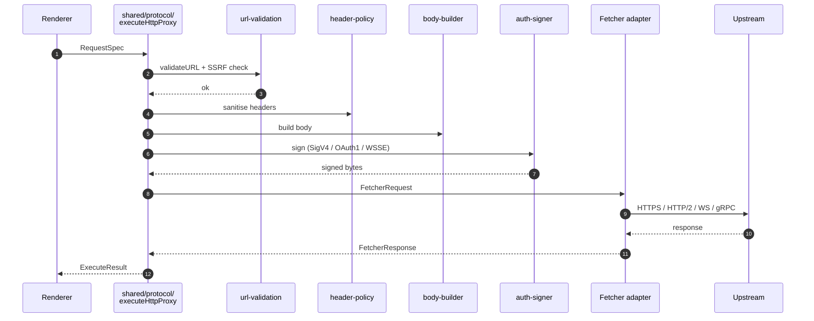

import { Aside, FileTree } from '@astrojs/starlight/components';

The shared protocol layer is the most important piece of Restura's architecture. It's the reason new protocols can be added in ~30 lines per backend instead of three full implementations.

## Request flow

A single request, end to end, goes through these stages — every stage except the transport adapter is shared code:

## The shape

Every protocol implementation in `shared/protocol/` exposes a `execute<Name>Proxy(spec, fetcher, options)` function. The `Fetcher` interface is the only thing each backend has to supply — everything else (SSRF guard, header policy, body construction, parsing) is shared.

<FileTree>
- shared/protocol/
  - types.ts                  `RequestSpec`, `Fetcher`, `ExecuteResult` (discriminated union)
  - url-validation.ts         SSRF guard — single source of truth
  - header-policy.ts          Hop-by-hop deny lists, header sanitisers
  - body-builder.ts           JSON, text, form-urlencoded, form-data, binary
  - http-proxy.ts
  - grpc-proxy.ts
  - mcp-proxy.ts
  - sse-parser.ts
  - ndjson-parser.ts
  - websocket-proxy.ts
  - auth-signer.ts            Wire-level auth signing
  - oauth1-signer.ts
  - wsse-header.ts
  - secret-value-schema.ts    `SecretRef` schema
  - crypto-utils.ts
  - ai/                       AI orchestrator
    - ai-proxy.ts
    - provider-routes.ts
    - providers/openai.ts, anthropic.ts, openrouter.ts
    - redaction.ts
</FileTree>

## The SSRF guard — one definition

`shared/protocol/url-validation.ts` is the single source of truth for what counts as a forbidden upstream:

- RFC 1918 (private networks).
- RFC 6598 (CGNAT range `100.64.0.0/10`).
- Link-local `169.254/16` — includes the cloud-metadata endpoint.
- Loopback (`127.0.0.0/8`, `::1`).
- IPv6 unique-local (`fc00::/7`).
- IPv4-mapped IPv6 (`::ffff:0:0/96`).
- The cloud-metadata addresses (`169.254.169.254`, GCE/AWS variants).

This single module is called by the Worker, the Node server, and the Electron main process. Before the refactor that introduced the shared layer, the guard had **drifted** between backends — adding it once and reusing everywhere is the whole point.

## Auth signed at the wire

`shared/protocol/auth-signer.ts`, `oauth1-signer.ts`, and `wsse-header.ts` sign **at the wire** — meaning the signing happens in the Worker / Electron main process, not in the renderer. This is necessary because:

- AWS SigV4 signs over the exact request bytes; signing in the renderer and then proxying through the Worker would change the bytes and invalidate the signature.
- OAuth 1.0 has the same property.
- WSSE PasswordDigest depends on a nonce and timestamp the upstream verifies.

The renderer hands the auth *spec* (method, credentials, region for SigV4, etc.) to the wire layer; the wire layer signs.

**Digest** is the challenge/response exception. Nothing is added to the first request. If the response is a `401` with a `WWW-Authenticate: Digest` challenge, `followRedirectsWithDigest` (`digest-auth.ts`) retries exactly once with an `Authorization: Digest` header. It only does this when every hop of the redirect chain stayed on the original origin, and the retry continues the same redirect budget. Both the buffered and the streaming paths do this, so every backend gets it. See [ADR 0029](/architecture/adrs/0029-digest-auth-challenge-retry/).

## Response decoding and `bodyNotice`

On the Worker and the Node server, the runtime's `fetch` decompresses response bodies. The Electron fetcher uses undici, which does not, so `electron/main/handlers/http-response-stream.ts` decodes `gzip`, `br`, `deflate` and `zstd`, including stacked codings. It decodes at most 3 stacked codings, limits zstd to an 8 MB window, and enforces the 10 MB response cap after every stage. When it can't decode a body, the fetcher returns the raw bytes and sets `FetcherResponse.bodyNotice`. The shared core copies that onto the response, and the viewer shows it above the body. Only the Electron fetcher sets `bodyNotice`.

## HTTP version override (desktop)

A request's `settings.httpVersion` (`auto`, `http1.1`, `http2`, `h2c-prior-knowledge`) is applied inside the Electron fetcher, not in `shared/protocol/`, because only the desktop app controls its own connections. On the Worker and the Node server the runtime negotiates the protocol, so web always behaves as `auto`. When HTTP/2 is forced, the desktop app checks for h2 **before** writing the request on direct and SOCKS connections. Through an HTTP or environment proxy the check runs after the response, so the request may already have gone out over HTTP/1.1. The CLI ignores the setting and prints one warning per run.

## Adding a new protocol

The recipe is now:

1. Add `shared/protocol/<name>-proxy.ts` exposing `execute<Name>Proxy(spec, fetcher, options)`.
2. Add a `Fetcher` adapter in `worker/handlers/<name>.ts` (≈30 lines).
3. Add a matching adapter in `electron/main/handlers/<name>-handler.ts` (≈30 lines).
4. Add a feature module in `src/features/<name>/` with the UI.
5. Add a capability entry (an area module under `src/lib/shared/capabilities/`, composed by `capabilities.ts`) if the feature differs between web and desktop.

SSRF guards, header sanitisers, body construction, and timeouts are all free.

## Where backend-specific code lives

Electron-only capabilities (PAC resolution, SOCKS4/5, mTLS, custom CA, pre-flight DNS guard via `dns-guard.ts`, the HTTP version override) live **inside the Electron fetcher closure** — not in `shared/protocol/`. Keep `shared/` backend-agnostic. ADR 0006 codifies this rule.

Redirects are the counter-example: every backend's fetcher sends with `redirect: 'manual'` and the shared `followRedirects` (`redirect-follower.ts`) follows 301/302/303/307/308, re-validating each hop against the SSRF guard and stripping credentials across origins. Electron used to wrap this in its own outer loop; that loop was removed because it re-sent credentials for the 300/304/305/306 responses the follower deliberately returns, so desktop now returns those as-is, like the web.

<Aside title="Deep dive">
See [`docs/ARCHITECTURE.md`](https://github.com/dipjyotimetia/restura/blob/main/docs/ARCHITECTURE.md) and [ADR 0001](/architecture/adrs/0001-shared-protocol-layer/) for the full design rationale.
</Aside>

## Related

- [Architecture overview](/architecture/overview/)
- [Security model](/architecture/security/)
- [Contract tests & CI](/testing/contract-and-ci/)
